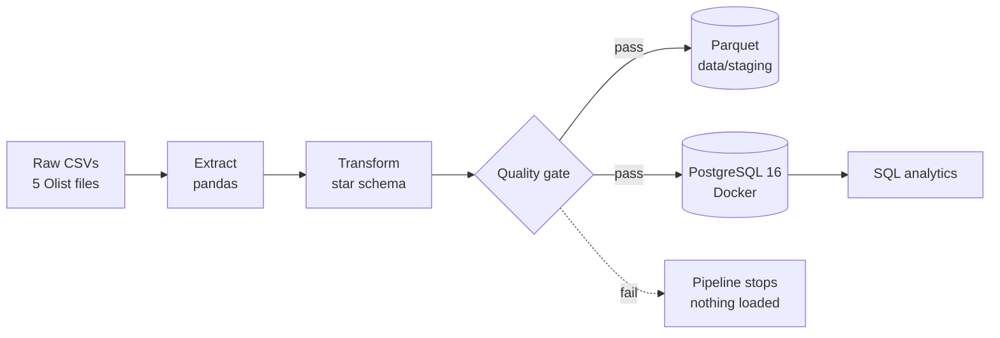
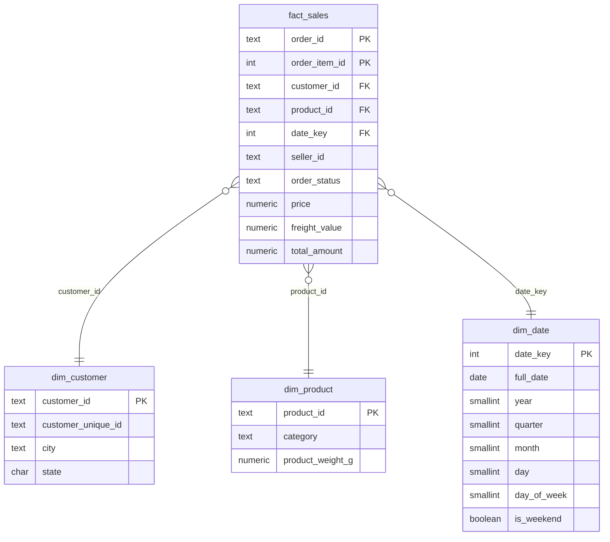

# Olist E-Commerce ETL Pipeline


A batch ETL pipeline that turns **~100k real Brazilian e-commerce orders** ([Olist dataset](https://www.kaggle.com/datasets/olistbr/brazilian-ecommerce))
from 5 raw CSV files into a **PostgreSQL star schema** and **Parquet** files, guarded by **data-quality checks**, covered by **unit tests**, and verified by **CI** on every push.

## Architecture



## Data model

Star schema at the grain of **one row per order item** `(order_id, order_item_id)`.



| Table | Rows |
|---|---:|
| `fact_sales` | 112,650 |
| `dim_customer` | 99,441 |
| `dim_product` | 32,951 |
| `dim_date` | 774 (every day 2016-09-04 → 2018-10-17) |

## Key engineering decisions

- **Idempotent, atomic load.** `TRUNCATE` + `COPY` run inside a single transaction: re-running the pipeline never duplicates data, and a failure mid-load rolls back to the previous good state.
- **Bulk `COPY` instead of row-by-row `INSERT`.** DataFrames are streamed to PostgreSQL through an in-memory CSV buffer.
- **Quality gate before load.** The pipeline refuses to load if the fact grain has duplicates, prices are negative, or any fact row references a missing dimension key (referential integrity).
- **Defence in depth.** The database enforces the same rules again with primary keys, foreign keys and a `CHECK (price >= 0)` constraint.
- **Complete date dimension.** Generated for every calendar day, not just days with sales, so reports show zero-sales days.
- **Parquet staging layer.** Typed, columnar output readable by Spark / DuckDB / Athena; **2.6x smaller** than the source CSVs (42.4 MB → 16.4 MB).
- **Pure, testable transforms.** Each table is built by a small DataFrame-in / DataFrame-out function, unit-tested without a database.

## Insights

From delivered orders (`sql/analytics.sql`), revenue in BRL:

| Question | Answer |
|---|---|
| Peak month | **Nov 2017**: R$ 1.15M, **+53.6%** month-over-month (Black Friday) |
| Top category | **health_beauty**: R$ 1.41M, followed by watches_gifts and bed_bath_table |
| Repeat-customer rate | only **3.05%** of customers ordered more than once, so retention is a clear growth opportunity |

> **Data gotcha:** Olist issues a new `customer_id` for every order. Counting repeat buyers on `customer_id` gives ~0%; the real person is `customer_unique_id`, which is why both are kept in `dim_customer`.

## Project structure

```
├── etl/
│   ├── config.py        # paths + connection string from .env
│   ├── extract.py       # read raw CSVs, log row counts
│   ├── transform.py     # build dimensions + fact table
│   ├── quality.py       # data-quality gate
│   ├── load.py          # atomic bulk load with COPY
│   └── pipeline.py      # entry point
├── sql/
│   ├── schema.sql       # DDL: tables, keys, constraints, indexes
│   └── analytics.sql    # business questions (CTEs, window functions)
├── tests/test_pipeline.py
├── .github/workflows/ci.yml
├── docker-compose.yml
└── requirements.txt
```

## Run it locally

**Prerequisites:** Python 3.10+, Docker Desktop.

```bash
# 1. Start PostgreSQL (exposed on port 5433)
docker compose up -d

# 2. Create a virtual environment and install dependencies
python -m venv .venv
source .venv/bin/activate          # Windows: .venv\Scripts\activate
pip install -r requirements.txt

# 3. Configure the connection string
cp .env.example .env               # then set user/password to match docker-compose.yml

# 4. Download the Olist dataset from Kaggle and put these files in data/raw/:
#    olist_orders_dataset.csv, olist_order_items_dataset.csv, olist_customers_dataset.csv,
#    olist_products_dataset.csv, product_category_name_translation.csv

# 5. Run the pipeline and the tests
python -m etl.pipeline
python -m pytest -q
```

Explore the results:

```bash
docker exec -i ecommerce_pg psql -U ecom_pg_admin -d ecommerce < sql/analytics.sql
```

## What I would do next

- **Incremental loads** using a watermark on `order_purchase_timestamp` and `INSERT ... ON CONFLICT` upserts
- **Orchestration** with Airflow or Prefect for scheduled runs
- **dbt models** for the transformation layer, with built-in tests and lineage
- **Partitioned Parquet on S3** and Spark for scale beyond a single machine
